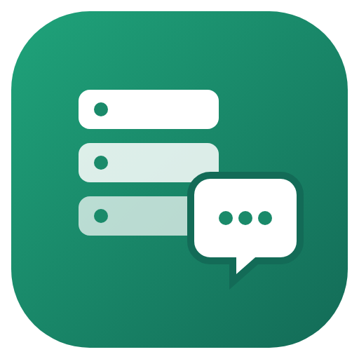

<p align="center"></p>

# discord-server-mcp

Create, organise and moderate **Discord servers from Claude** (or any MCP client) through your own bot.

Ask in plain words: *"set up a server for my gaming group"*, *"add a Solved tag to the help forum"*, *"post this announcement with the image and ping @Announcements"*, *"who can see #staff-chat?"*. The assistant reads the server, shows you the plan, and acts once you agree.

- **132 tools**, of which only a core of 48 is on at first; the rest turn on when a task needs them, plus `discord_api` for any other Discord endpoint.
- **Live events:** the assistant sees what happens as it happens: new messages, mentions of the bot, members joining or leaving, reactions and button clicks. It can also wait for something, such as a reply.
- **Automations:**
  - role menus with buttons, a dropdown or reactions;
  - welcome messages with auto-roles, and verification with an "I accept the rules" button;
  - numbered support tickets in private channels; a staff-only channel gets a line when each one opens (with a Claim button), is claimed and closes (with a summary and the full transcript), and `ticket_history` finds any past ticket;
  - support forums: new posts get an Open tag and a Solved button, staff can claim them, solved posts close, idle ones close after a few days;
  - the server's own slash commands, such as `/rules` or `/links`;
  - rules, "when this happens, do that": answer words, delete links, give a role on a reaction, DM new members, time out spammers;
  - scheduled and recurring messages, in any time zone;
  - moderation logs, in one channel, split by kind, or in a forum with one post per member and tags per kind (filter by member, kind or both): deleted and edited messages with what they said, joins and leaves, kicks, bans, timeouts, nickname and role changes with who did it and why, AutoMod blocks. The bot's own automations and ticket channels are left out, and every entry is kept for `search_mod_log` and `/modlog`;
  - staff alerts: a role ping in a staff channel and/or DMs on bans, kicks, timeouts, AutoMod blocks and raids;
  - staff slash commands inside Discord: `/lock`, `/unlock`, `/slowmode`, `/purge`, `/timeout`, `/untimeout`, `/kick`, `/ban`, `/unban`, `/role add|remove`, `/announce`, `/ticket close|claim`, `/modlog`. Discord shows each one only to members with the matching permission, they respect the role order, and the log shows who used them.

  Members see these texts in the server's language: English, Portuguese (Portugal and Brazil), Spanish, French, German, Italian, Russian, Japanese, Chinese (simplified), Korean, Polish or Turkish. Every text can be changed, then or later, so any other language works too. Staff command names can be in English, translated for each member, or in one language for everyone. They run while the assistant is open, or around the clock with `discord-server-mcp run` or Docker.
- **Background jobs:** big builds, role changes for many members, message backups (JSON, Markdown and HTML transcripts) and restores. Each job shows its progress and can be cancelled or resumed.
- **Local or remote:** stdio for desktop apps, or Streamable HTTP with a bearer token (`serve --http`).
- **Guided from zero:** `/discord` finds what is already set up, lets you pick a server, and walks you through creating a bot, adding it to an existing server, or creating a brand-new server. The new server gets built step by step: questions, plan, structure, rules and welcome texts, then Community, onboarding and AutoMod.
- **Several bots and servers:**
  - add as many bots as you like and move between their servers;
  - each request uses the bot that is in that server, or the one you chose for it;
  - every result says which bot acted.
- **Warns about 2FA:** when a server requires two-factor authentication for moderation, it says who needs 2FA and why.
- **Templates, layouts and backups:** build a whole server from a template, a layout you describe, or a backup. Only what is missing is created, and an interrupted build can be resumed.
- **Safe by design:**
  - every change can be previewed (`dry_run`);
  - permanent actions need `confirm: true`;
  - there are read-only and preview-only modes, an allow-list of servers and selectable tool packs;
  - nobody is pinged unless you ask.
- **Built for Claude:** a `/discord` command with a menu and a guided setup, and skills that make Claude show the plan before acting.
- **Easy install:**
  - one-click extension for Claude Desktop (asks for the token in a form);
  - a plugin for Claude Code;
  - a setup command (`init`) for every other client.
- **Names, not ids:** `announcements`, `@Moderator`, `alice`. Emoji prefixes are ignored when matching, and typos get "did you mean…?" suggestions.
- **Files and images** from your computer or the web, inside messages and embeds, and as icons, emojis and banners.
- **Online presence:** the bot shows as online with your status text while it runs.

## Install

### 1. Create the bot (2 minutes)

1. Go to [discord.com/developers/applications](https://discord.com/developers/applications), click **New Application**, open **Bot** and click **Reset Token**. Copy the token and keep it secret: it controls the bot.
2. Optional: on the same page, turn on **Server Members Intent** so member lists and role member counts work.
3. Add the bot to your server: **OAuth2 → URL Generator** → scope `bot` → permission **Administrator** → open the link. The `/discord` command and the `init` command also give you this link.
4. In **Server Settings → Roles**, drag the bot's role near the top. A bot can only manage roles and members below its own highest role.

### 2. Add it to your app

**Claude Desktop:** download `discord-server-mcp-<version>.mcpb` from the [latest release](https://github.com/pr5ias/discord-server-mcp/releases/latest) and double-click it. Claude Desktop shows a form; paste the token there. Node.js is not needed because Claude Desktop includes it.

**Claude Code:**

```
/plugin install discord-server --marketplace pr5ias/discord-server-mcp
```

Then run `/discord`: Claude walks you through creating the bot and asks for the token in a private box, or, if your app has none, on a one-time page in your browser at `127.0.0.1`. The token goes straight to the server and is saved in `~/.discord-mcp/bots.json`, never into the chat. On older versions, run `/plugin marketplace add pr5ias/discord-server-mcp` first, then `/plugin install discord-server@discord-server-mcp`. The same `.plugin` file from the releases also installs in the Claude app.

**Cursor, Windsurf, VS Code and other MCP clients** (needs Node.js 22+):

```bash
npx discord-server-mcp init
```

Without npm, clone this repository and run `node dist/index.mjs init` instead.

The wizard checks the token, saves it to `~/.discord-mcp/bots.json` (run it again to add more bots), prints the invite link, and adds the server to Claude Desktop, Claude Code, Cursor and Windsurf if you want. To set it up by hand, start the server with `npx -y discord-server-mcp` and give it the token as `DISCORD_BOT_TOKEN`.

### 3. Use it

Restart the app and type **`/discord`** (in Claude), or just ask *"show my Discord server"*. If something is off, `/discord setup` or `node dist/index.mjs check` tells you exactly what to fix.

## The `/discord` command

- `/discord` shows what is set up and asks which server to work on, or offers to add a bot, add it to another server, or create a new server. With no bot yet it explains how bots work and walks you through creating one. After you pick a server, a menu opens:
  - **Check-up:** finds problems, such as missing topics, empty channels, risky roles or a bot role that is too low.
  - **Build or reorganise:** templates, layouts and restores.
  - **Messages & announcements.**
  - **Roles, members & moderation.**
- **Build or reorganise** includes **Build a server from scratch**:
  1. Questions about the server: what it is for, languages, which areas, size.
  2. A starting point: a built-in template, a template from the internet, a copy of another of your servers, or your own description. It is adapted to your answers, then a **preview**: the channel sidebar as members will see it, the roles, and a grid of who can see and write where. Approve it, ask for changes, or try another template, as many times as you like.
  3. The structure: roles, channels and permissions.
  4. The rules, welcome, FAQ and first announcement, written for you to approve before they are posted.
  5. Optional settings: Community, onboarding, the welcome screen, verification, AutoMod and an invite link.
- `/discord setup` walks through the setup one step at a time.
- `/discord <request>` skips the menu, e.g. `/discord build the project template`.

## Tools

132 tools in packs. Only the **core** pack (48 tools) is on at first, so the model has fewer tools to choose from and each request stays small. When a task needs more, the assistant calls `enable_tools` and the pack appears at once. In apps that do not refresh their tool list, the assistant calls the same tools through `use_tool`, so nothing is out of reach. `DISCORD_TOOLSETS=all` turns everything on.

| Pack | Tools |
| --- | --- |
| **core** (always on) | `setup_check` (bots, their servers, what to fix, 2FA notes, invite links), `list_bots`, `add_bot` (private token box or a one-time local page, never in the chat), `use_bot`, `set_server_bot`, `remove_bot`, `bot_invite_link`, `configure`, `enable_tools`, `use_tool`, `list_servers`, `get_server`, `edit_server`, `create_invite`, `create_category`, `create_channel` (text, announcement, forum, media, voice, stage; private), `edit_channel`, `delete_channel`, `reorder_channels`, `set_permissions`, `set_forum_tags`, `create_forum_post`, `create_thread`, `read_messages`, `get_message`, `send_message` (embeds, files, link buttons, polls, replies, pings, silent, publish), `edit_message`, `delete_messages`, `pin_message`, `react`, `search_messages`, `list_roles`, `create_role`, `edit_role`, `delete_role`, `list_members`, `get_member`, `set_member_roles`, `timeout_member`, `kick_member`, `ban_member`, `check_permissions` (effective permissions; who can see a channel), `list_templates`, `import_discord_template` (discord.new links), `preview_blueprint` (sidebar, roles and a who-sees-what grid), `export_server_structure`, `apply_blueprint`, `job_status` |
| **automations** | `create_role_menu` (buttons or reactions), `set_welcome` (message, embed, DM, auto-roles), `create_ticket_panel`, `create_command` (the server's own slash commands), `set_mod_log` (moderation log channel or forum), `set_staff_alerts`, `enable_staff_commands`, `search_mod_log`, `ticket_history`, `set_support_forum`, `create_rule`, `create_verification`, `schedule_message`, `edit_automation` (language and any text, later), `list_automations`, `remove_automation`. Menus and tickets take `language` and `texts` to change what members see. |
| **live** | `events_status`, `get_events` (messages, mentions, edits, deletions, reactions, joins, leaves, bans, threads, clicks), `wait_for_event` |
| **jobs** | `list_jobs`, `cancel_job`, `resume_job`, `bulk_role_update`, `backup_messages`, `restore_messages` |
| **moderation** | `lock_channel`, `unlock_channel`, `purge_messages`, `list_automod_rules`, `create_automod_rule`, `delete_automod_rule`, `prune_members`, `audit_roles`, `get_audit_log`, `list_bans`, `unban_user`, `edit_member`, `reorder_roles`, `export_members` (CSV) |
| **messaging** | `list_webhooks`, `create_webhook`, `delete_webhook`, `send_webhook_message` (custom name and avatar), `edit_webhook_message`, `send_dm`, `list_pins`, `publish_message`, `end_poll`, `list_reactions`, `poll_results` |
| **organizing** | `clone_channel`, `add_forum_tags`, `list_threads`, `edit_thread`, `follow_announcement_channel`, `sync_permissions`, `copy_permissions` |
| **server_settings** | `get_onboarding`, `edit_onboarding`, `edit_welcome_screen`, `list_invites`, `delete_invite`, `server_stats`, `channel_activity`, `edit_bot_profile`, `create_server`, `leave_server` |
| **expressions** | `list_emojis`, `create_emoji`, `delete_emoji`, `create_sticker`, `delete_sticker`, `list_sounds`, `create_sound`, `delete_sound`, `list_events`, `create_event`, `edit_event`, `delete_event`, `start_stage`, `end_stage`, `list_commands`, `delete_command` |
| **api** | `discord_api`: any REST endpoint (`{guild}` in the path becomes the server id) |

### Templates and backups

`preview_blueprint` and `apply_blueprint` accept any of these:
- a built-in template: `community`, `gaming`, `creator`, `project` or `study`. They follow the structure most servers use: an information area with welcome, rules and announcements, community chat, topic or support areas, voice, and a private staff area.
- a **Discord template from the internet** (`discord_template`: a `discord.new/…` link from a site such as discords.com/templates);
- **another server** the bot is in (`copy_from_server`);
- a JSON file from `export_server_structure`;
- a layout written on the spot:

```json
{
  "roles": [{ "name": "Event Host", "color": "#e67e22" }],
  "categories": [{
    "name": "Events",
    "channels": [
      { "name": "📅-event-announcements", "type": "announcement", "topic": "Upcoming events",
        "overrides": [{ "target": "@everyone", "deny": ["SendMessages"] }, { "target": "Event Host", "allow": ["SendMessages"] }] },
      { "name": "💬-event-chat", "type": "text", "topic": "Talk about the events" },
      { "name": "🎙️-event-stage", "type": "stage" }
    ]
  }]
}
```

- `mode: "plan"` lists the steps and changes nothing. `mode: "apply"` carries them out.
- Existing roles, categories and channels are matched by name, with emojis and dashes ignored, and are reused.
- Missing forum tags and topics are added.
- Nothing is ever deleted.
- With `update_existing: true` it also moves channels into place, updates roles that differ, and reorders everything.

## Running around the clock and remotely

Role menus, welcomes, tickets, slash commands and the moderation log need a bot that is online. The MCP server keeps the bots online while your AI app is open. To keep them working all the time, run this on a computer or server that stays on:

```bash
node dist/index.mjs run        # or: npx discord-server-mcp run
```

Or with Docker. Settings, bots and automations are kept in the `/data` volume. Copy `~/.discord-mcp/automations.json` into it to bring over what you set up in Claude.

```bash
docker build -t discord-server-mcp .
docker run -d --restart unless-stopped --name discord-bot \
  -v discord-data:/data -e DISCORD_BOT_TOKEN=<token> discord-server-mcp
```

Add `serve --http --host 0.0.0.0` at the end, `-p 3333:3333` and `-e DISCORD_MCP_HTTP_TOKEN=<secret>` to serve the MCP tools over HTTP from the container instead.

To use the tools from another machine, serve MCP over HTTP:

```bash
DISCORD_MCP_HTTP_TOKEN=<long random secret> node dist/index.mjs serve --http --port 3333
```

- **Endpoint:** clients connect to `http://<host>:3333/mcp` and send `Authorization: Bearer <secret>`.
- **Who can reach it:** it listens on 127.0.0.1 only. Add `--host 0.0.0.0` and put HTTPS in front to reach it from elsewhere.
- **Health check:** `/health` reports the version and whether each bot is connected.

**Intents.** For message text (and the text of deleted messages in the moderation log) and member join events, open the Developer Portal → **Bot** and turn on **Message Content** and **Server Members**. Without them the live features still work, but message text comes through empty and joins are not seen. `events_status` shows which intents are active.

## Safety settings

Just ask Claude ("only show changes, don't apply them", "set the bot's status to My Server"): the `configure` tool saves them in `~/.discord-mcp/settings.json`. The Claude Desktop extension also asks for the main ones during install. Environment variables with the same names override the file.

| Variable | Default | Meaning |
| --- | --- | --- |
| `DISCORD_BOT_TOKEN` | none | A bot token. Bots added from the chat or with `init` are saved in `~/.discord-mcp/bots.json`. A token on the first line of `~/.discord-mcp/token.txt` is also read (`DISCORD_TOKEN_FILE` changes that path). |
| `DISCORD_ACTIVE_BOT` | first bot | Name or id of the bot used when a request names no server (`use_bot` sets it). |
| `DISCORD_SERVER_BOTS` | none | JSON `{"<server id>": "<bot>"}` choosing the bot per server (`set_server_bot` sets it). |
| `DISCORD_WRITE_MODE` | `full` | `preview`: every change is only shown. `readonly`: no changing tools at all. |
| `DISCORD_CONFIRM_DESTRUCTIVE` | `on` | Permanent actions (delete, kick, ban, purge, prune…) return a preview until called with `confirm: true`. |
| `DISCORD_ALLOWED_GUILDS` | all | Comma-separated server ids the tools may touch. |
| `DISCORD_TOOLSETS` | core only | Extra packs on from the start, e.g. `automations,moderation`, or `all`. The core is always on and `enable_tools` adds packs later. |
| `DISCORD_GUILD_ID` | none | Default server when the bot is in several. |
| `DISCORD_GATEWAY` | `on` | `off` = no live connection: no events, automations or online status. |
| `DISCORD_PRESENCE` | `on` | `off` = connected but shown as invisible. |
| `DISCORD_MCP_HTTP_TOKEN` | none | Bearer secret required by `serve --http`. |
| `DISCORD_PRESENCE_TEXT` | none | Status text, e.g. `My Server` shows "Watching My Server". |
| `DISCORD_PRESENCE_TYPE` / `_STATUS` | `watching` / `online` | `playing`, `listening`, `watching`, `competing`, `custom` / `online`, `idle`, `dnd`, `invisible`. |

Tools carry MCP annotations (read-only, destructive), so clients can ask before running them. Audit-log reasons are supported on moderation tools.

## Sharing a bot

Two people can use the same bot from their own computers. Each one adds the same token with `add_bot`.

- **Share it through a Team:** in the Developer Portal, go to Teams → New Team, invite the person, then open the app's General Information and click Transfer App to Team. Don't send the token in a chat.
- **Resetting the token affects everyone:** a reset gives a new token, so agree before doing it.
- **The audit log can't tell you apart:** every change shows as the bot. If you need to know who did what, give each person their own bot.

When several bots are in one server, every result says which bot acted, `set_server_bot` chooses the bot for that server, and any request can pass `bot`.

## Limits

- **New servers:** Discord rarely lets bots create servers. Create the server in the app, invite the bot, then build it with a template.
- **Role order:** a bot cannot manage roles or members at or above its own highest role.
- **Other bots' messages** cannot be edited. Re-post them and delete the old ones.
- **Always-on features:** role menus, welcomes, tickets, slash commands and the moderation log work only while the server runs. Use `run` or Docker on an always-on machine to keep them working all the time. Slash commands answer with fixed texts; they do not run other actions.
- **Bulk delete** only works on messages younger than 14 days. Older ones are deleted one by one.
- **Message search** scans recent messages per channel, because Discord's search API is not available to bots.
- **Your own account is never used.** Automating a personal account (a "selfbot") breaks Discord's terms and can get the account banned.

## Publishing (maintainers)

```bash
npm publish                      # makes `npx discord-server-mcp` work
mcp-publisher login github       # https://github.com/modelcontextprotocol/registry
mcp-publisher publish            # lists server.json in the official MCP registry
```

## Development

```bash
npm install
npm test          # builds, then runs every tool pack against a fake Discord API
npm run package   # release/: the .mcpb extension and the .plugin file
```

- **Source:** `src/`, plain JavaScript ES modules.
  - `discord.js`: REST client, lookups and dry runs.
  - `tool.js`: write modes and tool packs.
  - `tools/*.js`: the tools.
  - `templates.js`: server templates.
  - `cli.js`: `init` and `check`.
- **Build:** `dist/index.mjs` is the bundled server and is committed, so the plugin works straight from the repository.
- **Releases:** run `npm test` and `npm run package`, then attach the two files from `release/` to a GitHub release tagged `v<version>`.

## License

MIT
